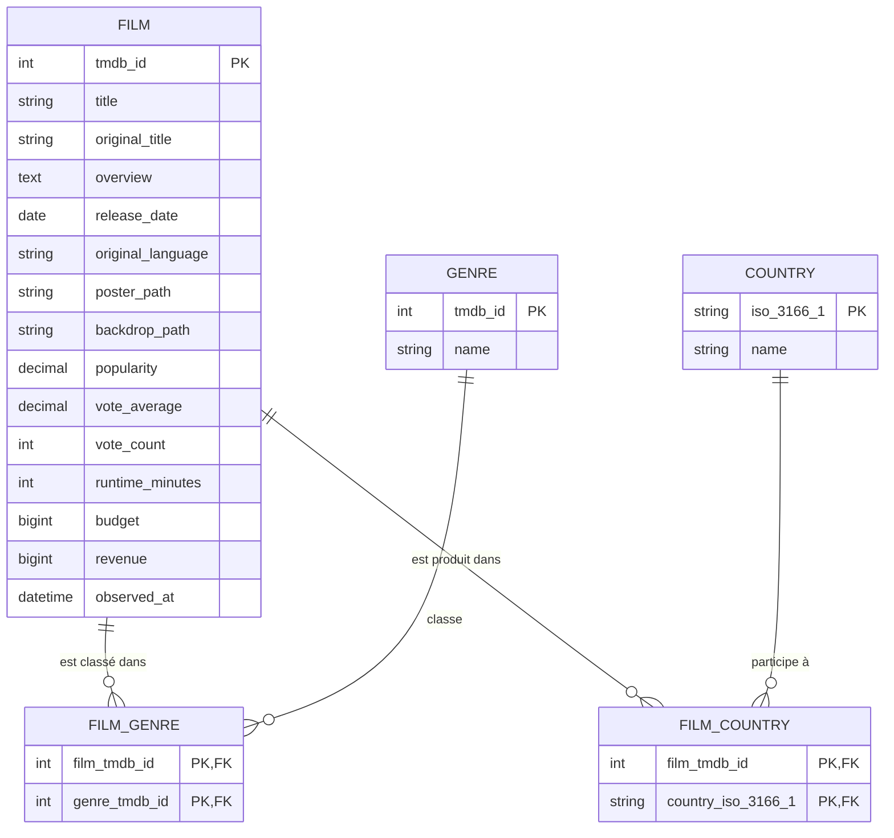

# Modèle de données du tableau de bord des films

Ce modèle couvre l'échantillon de films collecté depuis TMDB Discover et
complété par la fiche détaillée de chaque film.

## Périmètre fonctionnel

- Un film est identifié par son identifiant TMDB.
- La date de sortie permet de filtrer et d'agréger les films par année.
- Un film peut avoir plusieurs genres et un genre peut être associé à plusieurs
  films.
- Un film peut avoir plusieurs pays de production et un pays peut participer à
  plusieurs films.
- Une collecte répétée met à jour le film existant et ses associations sans
  créer de doublon.
- Une durée, un budget ou une recette nulle est stockée comme inconnue (`NULL`).
  Si elle est renseignée, elle est strictement positive.
- Une popularité, une note ou un nombre de votes absent est stocké comme
  inconnu (`NULL`), et non comme zéro.

## MCD



### Cardinalités et règles d'unicité

| Relation                   | Cardinalité         | Règle                                                 |
| -------------------------- | ------------------- | ----------------------------------------------------- |
| `FILM` — `GENRE`           | 0..N de chaque côté | La paire film/genre est unique.                       |
| `FILM` — `COUNTRY`         | 0..N de chaque côté | La paire film/pays est unique.                        |
| `FILM` — `FILM_GENRE`      | 1 côté association  | Une association référence toujours un film existant.  |
| `GENRE` — `FILM_GENRE`     | 1 côté association  | Une association référence toujours un genre existant. |
| `FILM` — `FILM_COUNTRY`    | 1 côté association  | Une association référence toujours un film existant.  |
| `COUNTRY` — `FILM_COUNTRY` | 1 côté association  | Une association référence toujours un pays existant.  |

Un film peut ne posséder aucun genre ou pays connu (`0..N`). Les catalogues
TMDB sont donc indépendants des films déjà importés. La suppression d'un film
supprime ses associations (`ON DELETE CASCADE`), mais la suppression d'un
genre ou d'un pays référencé est interdite (`ON DELETE RESTRICT`).

## Schéma relationnel

```text
FILM(
  tmdb_id PK,
  title,
  original_title,
  overview,
  release_date,
  original_language,
  poster_path,
  backdrop_path,
  popularity,
  vote_average,
  vote_count,
  runtime_minutes,
  budget,
  revenue,
  observed_at
)

GENRE(tmdb_id PK, name)
COUNTRY(iso_3166_1 PK, name)
FILM_GENRE(film_tmdb_id PK/FK -> FILM.tmdb_id,
           genre_tmdb_id PK/FK -> GENRE.tmdb_id)
FILM_COUNTRY(film_tmdb_id PK/FK -> FILM.tmdb_id,
             country_iso_3166_1 PK/FK -> COUNTRY.iso_3166_1)
```

`release_date` reste attachée au film lors d'un upsert : actualiser un film ne
le déplace donc pas vers une autre année et ne crée pas une seconde ligne.
`observed_at` est remplacée par la date de la dernière observation.
